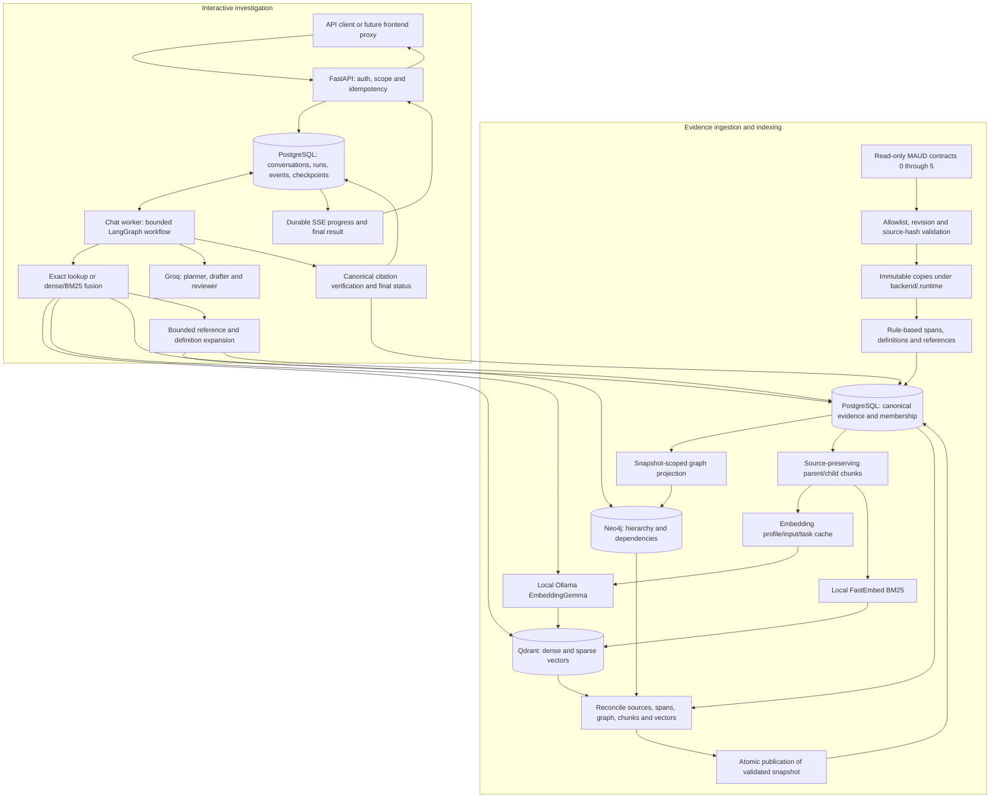
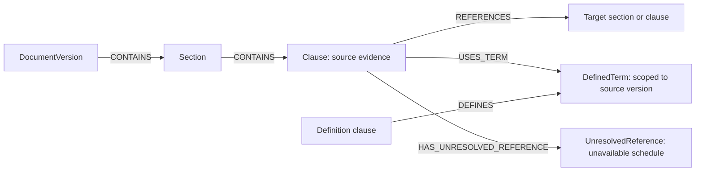
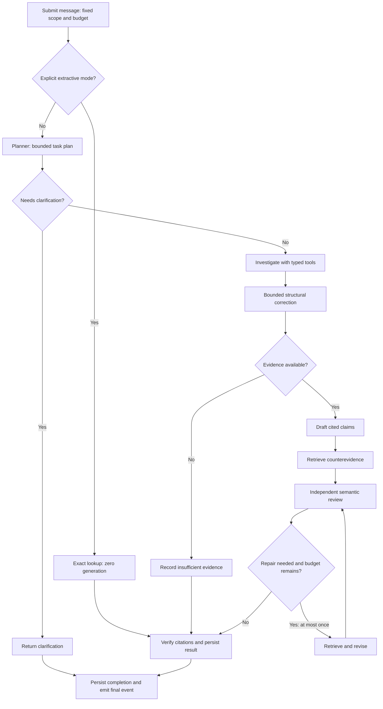

# AccordTrace — M&A Agreement Research Harness

**Multiagent GraphRAG, bounded corrective retrieval, and findings you can trace to their source.**


## Why this problem matters

A merger agreement rarely answers a diligence question in one self-contained paragraph. A termination right may depend on a closing condition, a defined term, an exception elsewhere, and a schedule that is unavailable. The same section number or capitalized term can mean something different in another agreement.

A reviewer must find relevant language, establish its version, follow dependencies, check contrary provisions, and explain what the available documents cannot establish. A fluent answer without that evidence trail is difficult to audit.

> **Example investigation:** “When can the buyer terminate if regulatory approval is delayed, which exceptions apply, and what evidence is missing?”

AccordTrace explores how retrieval, graph structure, and separate agent roles can support this work. Its intended value is faster source navigation and more reviewable findings for analysts and transaction reviewers. It does not establish that approval actually occurred or replace legal judgment. Time savings and quality improvements have not yet been measured.

## The solution

AccordTrace is a **research harness**: a controlled backend supplying agents with scoped evidence tools, model gateways, execution budgets, durable state, and citation checks. It makes the investigation behind a finding—or an abstention—inspectable.

The backend ingests six real MAUD agreements, preserves immutable evidence in PostgreSQL, projects their structure into Neo4j, and indexes retrieval chunks in Qdrant. A LangGraph workflow plans the investigation, retrieves evidence, attempts bounded corrections, drafts claims, searches for counterevidence, reviews support, and verifies citations.

The output contains claims, exact quotations, source versions, offsets, review findings, and unresolved gaps. Authenticated APIs, durable SSE progress, conversation history, source inspection, cancellation, traces, and JSON/Markdown exports support frontend integration.
.

## Technology choices

| Component | Technology | Reason |
|---|---|---|
| API and validation | Python 3.12, FastAPI, Pydantic | Typed requests, scope constraints, HTTP/SSE contracts |
| Agent execution | LangGraph | Conditional stages and persistent checkpoints |
| Canonical store | PostgreSQL 16, SQLAlchemy, psycopg, Alembic | Evidence, transactions, snapshot membership, jobs, runs, and events |
| Knowledge graph | Neo4j 5.26 Community | Explicit hierarchy, reference and definition paths |
| Search projection | Qdrant | Scoped dense and sparse retrieval |
| Sparse representation | FastEmbed `Qdrant/bm25` | Local lexical matching for terminology and identifiers |
| Token sizing | Pinned `BAAI/bge-small-en-v1.5` tokenizer | Repeatable chunk/context sizing; not the dense embedding model |
| Embeddings | Ollama `embeddinggemma:300m` | Local normalized 768D vectors, pinned model/runtime/prompts |
| Planning and drafting | Groq `openai/gpt-oss-20b` | Structured plans, cited claims, and revisions |
| Review | Groq `openai/gpt-oss-120b` | Separate support/conflict assessment |
| Containers | Docker and Docker Compose | API/workers plus persistent stores and health checks |
| Dependencies | uv, `pyproject.toml`, `uv.lock` | One resolver-generated dependency system |
| Verification | pytest, TestClient, HTTPX, integration scripts | Provenance, scope, state, HTTP/SSE, and failure-path checks |

**Gemini is removed.** There is no Google API SDK/key requirement or automatic provider substitution. GPT-OSS runs through Groq, not the OpenAI API. Hosted calls require explicitly configured, free-tier-confirmed credentials and respect configured quotas.

`ACCORDTRACE_OFFLINE_MODE=true` is retained for compatibility and means **local embeddings only**; false is rejected. Chat still needs hosted Groq. Google-origin EmbeddingGemma is a local open model, separate from the removed Gemini service.

## Implemented backend architecture

PostgreSQL is the source of truth. Neo4j and Qdrant are rebuildable projections of one source/configuration snapshot. Each conversation pins a snapshot and agreement scope, preventing silent version mixing.



### 1. Ingestion and parsing

The initial manifest pins six filenames, dataset revision, and SHA-256 hashes. Ingestion preserves raw bytes, decoded text, canonical hashes, and immutable version IDs. Normalized matching views retain mappings to original text; citations use canonical source offsets.

The parser identifies operative sections/clauses, definition scopes, term occurrences, and reference mentions. It separates table-of-contents navigation from operative language and records ambiguous/unparsed material. Supplements have separate structural scopes; their presence does not imply legal supersession.

Original `data/maud/` files stay read-only. Derived sources, tokenizer/BM25 assets, reports, and runtime artifacts belong under ignored `backend/.runtime/`.

### 2. Indexing and safe knowledge-base updates

Parent clauses preserve context; child chunks support retrieval. The chunker targets about 320 tokenizer tokens, maximum 360, overlap up to 40, and a 1,536-byte embedding-input cap including breadcrumbs. The byte cap can shorten chunks further. Each child retains its parent, source range, and text hash.

Embedding cache identity includes the complete profile, input hash, and task. Model digest, Ollama runtime, normalization, and document/query prefixes are pinned. Equal dimensions do not make different embedding spaces compatible.

Qdrant stores named dense/BM25 vectors in snapshot-specific collections. Builds stay inactive until source membership, canonical spans/chunks, graph targets/counts, and vectors reconcile. Activation uses an atomic generation check; interrupted builds cannot become search-ready accidentally.

Approved manifests can stage added documents, new versions, and explicitly identified attachments. Unchanged artifacts may be reused; changed evidence gets new identities and a staged snapshot. Existing conversations keep their old snapshot. This is operator-controlled, not a general upload endpoint.

### 3. Retrieval and GraphRAG

Exact section/defined-term lookup complements semantic retrieval. Hybrid search takes up to 20 dense and 20 BM25 candidates per selected agreement, combines rankings with reciprocal rank fusion, removes overlapping evidence, and distributes seeds across agreements. No learned reranker is installed.

Expansion follows allowlisted patterns: a direct reference, two successive references, or term use back to its definition. Canonical quotations come from PostgreSQL. Every tool enforces approved versions, snapshot membership, and agreement scope.

Packets include excerpts, parent links, graph paths, unresolved dependencies, warnings, and limits. Dense inference failure can produce an explicitly labelled lexical degradation; it does not switch embedding providers. Graph unavailability is also surfaced. Similarity scores are ranking signals, not confidence or completeness guarantees.

### 4. Durable answering and provenance

Submission creates a persisted run; a separate worker executes it. PostgreSQL holds messages, budgets, tool/model attempts, evidence labels, events, and checkpoints. Leases/fencing protect completion; uncertain remote calls are not refunded after a crash.

Citations carry agreement/version IDs, canonical span/chunk IDs, source/text hashes, exact quote, and end-exclusive Unicode code-point offsets. Code verifies identity, membership, bounds, and text integrity. The reviewer separately judges semantic support; matching text alone does not prove a claim.

SSE emits stages and final results, not unverified draft tokens. Reconnection replays durable events rather than submitting another question. Exports retain findings and gaps. Scope, idempotency conflicts, cancellation, quota waits, and service failure remain explicit states.

## Knowledge graph: nodes, relations, and rationale

The graph represents **document structure and evidence dependencies**, not an inferred transaction ontology. Every node has a common `KBNode` label, canonical artifact ID, and snapshot-specific projection identity.

### Nodes

| Label | Represents | Why selected |
|---|---|---|
| `DocumentVersion` | Immutable source version | Prevents mixing agreements/revisions |
| `Section` | Structural section with source bounds/label | Exact lookup and hierarchy-aware context |
| `Clause` | Quotable span, including nested/definition text | Keeps actual evidence addressable |
| `DefinedTerm` | Document/version-scoped term | Prevents merging unrelated “Company” or “Effective Time” definitions |
| `UnresolvedReference` | Target that cannot safely be established | Keeps missing, partial, ambiguous and out-of-corpus dependencies visible |

### Relationships

| Relation | Direction | Why selected |
|---|---|---|
| `CONTAINS` | Document/parent span → child section/clause | Recover context through actual hierarchy |
| `DEFINES` | Definition-bearing span → scoped term | Link meaning to its source |
| `USES_TERM` | Source span → scoped term | Traverse term occurrence back to definition |
| `REFERENCES` | Source span → resolved target span | Encode verified or snapshot-resolved explicit references |
| `HAS_UNRESOLVED_REFERENCE` | Source span → unresolved reference | Preserve dependencies even when evidence is unavailable |

Reference/term-use edges retain occurrence offsets and provenance identifiers. A location-only term entry does not receive a `DEFINES` edge as though its definition text was recovered. Graph loading reconciles targets; missing targets cannot silently disappear.

Schematic illustration, not an asserted subgraph from one particular contract:



`QUALIFIES`, `CONFLICTS_WITH`, and party/obligation edges are not installed as unquestioned legal facts. Future semantic edges require source evidence, extraction method, validation status, and scope.

### Rule-based today; fine-tuned parsing later

Extraction is deterministic Python parsing, not an NER service. Heading/TOC rules, scoped term matching and reference resolution create records; graph code persists them. Embeddings rank text similarity and do not create entities.

A future fine-tuned model could propose section boundaries, definitions, mentions, or typed relations for more varied documents. This requires adding a parser adapter, not flipping an existing environment flag. Predictions must produce the evidence-preserving `Parsed` contracts—`spans`, `terms`, `references`, `uses`, `issues`—align to original offsets, and pass scope/reference validation.

NER alone cannot determine which “Company” is meant, whether a reference is operative, or whether an exception legally qualifies a clause. Those require resolution and relationship-specific checks. Changed parser/model versions require new derived artifacts and staged projections, preserving old citations. Fine-tuning/model-assisted parsing is future work.

## Agentic architecture

Specialized roles operate inside one durable LangGraph workflow. Investigation, correction, counterevidence retrieval, and citation checks are constrained tools/code—not all separate LLM agents.

| Role/stage | Implementation | Responsibility |
|---|---|---|
| Router | Deterministic | Interpretive investigation or explicit extractive lookup |
| Planner | Groq GPT-OSS 20B | Resolve intent; plan at most three scoped tasks |
| Investigator | Typed tools | Search, section/term lookup, parent/graph expansion |
| Structural correction | Deterministic, CRAG-inspired | Repair empty retrieval or an unexpanded section dependency |
| Drafter | Groq GPT-OSS 20B | Structured claims with server-issued evidence labels/quotes |
| Counterevidence probe | Independently constructed retrieval query | Search exceptions, exclusions, limitations and contrary context |
| Reviewer | Groq GPT-OSS 120B | Judge support/conflict; optionally request targeted repair |
| Revision | Tools + GPT-OSS 20B | Retrieve/revise once if budgets permit, then re-review |
| Citation finalizer | Deterministic | Verify canonical evidence; publish supported material/gaps/abstention |



This is **CRAG-inspired bounded correction**, not a reproduction of a separately benchmarked CRAG research system. It cannot browse the web, run generated SQL/Cypher, invent schedules, or reset budgets.

### Efficiency and safety limits

| Control | Current maximum/default |
|---|---|
| Planner tasks | 3 |
| Physical generation calls, including retry/repair | 5 per run |
| Retrieval calls / corrective actions | 6 / 2 |
| Draft revision / schema repair | 1 each, within the generation cap |
| Additional graph units / embedding calls | 12 / 6 |
| Search seeds / traversal | Up to 6 / bounded two-hop paths |
| Selected evidence context | Up to 3,000 tokenizer tokens |
| Active execution / absolute lifetime | 30 seconds / 600 seconds by default |
| Generation request timeout | 20 seconds by default |

Counters survive checkpoint resume. Payload fitting records omitted context; revision must leave room for independent re-review. Cache reuse, local sparse search, exact zero-generation lookup, and a single model-intensive worker reduce redundant work. These are implementation choices, not measured latency claims.

Planning/drafting share GPT-OSS 20B quota accounting. Free-plan limits can cause `waiting_quota` even when calls are fast. Waiting is visible separately from active processing. No account rotation or paid fallback is used.

## Dataset, benchmark context, and testing

**MAUD—Merger Agreement Understanding Dataset**, from The Atticus Project, is an expert-annotated legal reading-comprehension resource based on the ABA public-target deal-points study. Its paper reports over 39,000 examples and over 47,000 annotations; the dataset repository lists **CC BY 4.0**. Attribution: [Wang et al., EMNLP 2023](https://aclanthology.org/2023.emnlp-main.1019/) and [The Atticus Project dataset](https://huggingface.co/datasets/theatticusproject/maud).

The pinned local download manifest records:

| Asset | Local count |
|---|---:|
| Contract text files | 100 |
| Training annotation rows | 25,827 |
| Development annotation rows | 6,753 |
| Test annotation rows | 6,651 |
| Total annotation rows | 39,231 |

Revision: `37d5c3b95d18dcd8404cc5ce3fd5069be062392f`. Location: `data/maud/`. The download manifest records acquisition time, revision, file count and CSV hashes. `backend/configs/corpus.initial.yaml` separately pins selected-contract hashes.

**Only six allowlisted full-text agreements are indexed. Gold answers, annotation CSVs, documentation, and other contracts are excluded.** Public benchmark split sizes do not mean this application was evaluated on those splits. Original/counterfactual provenance must be preserved if annotations are later used for evaluation.

### What has actually been tested

| Layer | Inputs/infrastructure | Establishes |
|---|---|---|
| Unit/API | Synthetic fixtures and mocked SDKs | Parsing, validation, budgets, routing and failure semantics |
| Phase 2 integration | Real PostgreSQL/Neo4j/Qdrant; synthetic dense vectors; selected contracts | Index/cache mechanics, scope, updates and publication |
| Phase 3 integration | Real stores/checkpoints; scripted generation; synthetic dense vectors | Workflow, citation guards, recovery, HTTP/SSE and cancellation |
| Local inference/index validation | Real Ollama and six agreements | Embedding compatibility and complete reconciliation |
| Hosted HTTP smoke | Real Groq and active local index | Direct answer/citations and operations; supported follow-up remains limited |

The live direct example recovered the `$115.00` Per Share Cash Amount from `contract_0` with verified citations. Its overall result was `partially_supported`, preserving gaps. The follow-up returned `insufficient_evidence` after semantic review, not a provider outage. This is smoke-check evidence, not a quality benchmark.

**Deferred evaluation:** reviewed gold-label/span alignment, agreement-level splits, evidence recall, citation support, finding correctness, appropriate abstention, Ragas/judge integration, retrieval/agent ablations, and latency/load benchmarks. Future comparisons must use equivalent access and budgets. No quality score is claimed.

## Repository structure

The tree below shows tracked repository content available from a clone. All backend implementation lives under `backend/`; root uv metadata is shared. Package initializers are omitted for readability.

```text
.
├── README.md
├── AGENTS.md                         # Repository/phase instructions
├── pyproject.toml                    # Dependencies, packaging and CLI metadata
├── uv.lock                           # Resolver-generated lockfile
├── .python-version
├── .gitignore
├── scripts/
│   └── uv.py                         # Project-local uv launcher
├── data/
│   └── download_maud.py              # Revision-pinned downloader/manifest
└── backend/
    ├── .env.example                  # Safe configuration template
    ├── Dockerfile
    ├── Dockerfile.dockerignore
    ├── compose.yaml                  # API/workers and three persistent stores
    ├── compose.dev.yaml              # Explicit source-mount overlay
    ├── alembic.ini
    ├── configs/
    │   └── corpus.initial.yaml       # Six-contract revision/hash allowlist
    ├── migrations/
    │   ├── env.py
    │   └── versions/
    │       ├── 0001_canonical.py
    │       ├── 0002_stage_and_indexes.py
    │       ├── 0003_search_foundation.py
    │       ├── 0004_logical_source_identity.py
    │       └── 0005_chat_runtime.py
    ├── src/accordtrace_backend/
    │   ├── api/
    │   │   └── app.py                # Health, sources, search, snapshots, admin
    │   ├── common/
    │   │   └── core.py               # Settings, hashes, IDs, domain errors
    │   ├── persistence/
    │   │   └── storage.py            # Canonical SQLAlchemy models/engine
    │   ├── ingestion/
    │   │   ├── parsing.py            # Rules for spans, terms and references
    │   │   └── pipeline.py           # Source validation, artifacts, leased jobs
    │   ├── indexing/
    │   │   ├── chunking.py           # Parent/child ranges and embedding inputs
    │   │   ├── embedding.py          # Assets, profiles, dispatch and cache
    │   │   ├── ollama.py             # Local, digest-checked embedding I/O
    │   │   ├── pipeline.py           # Build, reconcile, publish and pin snapshots
    │   │   └── updates.py            # Approved manifests, versions, attachments
    │   ├── integrations/
    │   │   ├── graph.py              # Neo4j schema/projection/reconciliation
    │   │   └── vectorstore.py        # Qdrant collections, vectors and scope
    │   ├── retrieval/
    │   │   └── search.py             # Exact/hybrid search and bounded traversal
    │   ├── chat/
    │   │   ├── api.py                # Conversations, runs, SSE, trace, exports
    │   │   ├── schemas.py            # Strict plans, tools, drafts, reviews
    │   │   ├── models.py             # Runs, events, evidence/provider tables
    │   │   ├── repository.py         # Ownership, idempotency, leases, budgets
    │   │   ├── providers.py          # Groq, quotas, bounded repair/retry
    │   │   ├── prompts.py            # Role prompts, models, workflow version
    │   │   ├── workflow.py           # LangGraph stages and transitions
    │   │   ├── evidence.py           # Scoped tools and citation verification
    │   │   ├── checkpoints.py        # PostgreSQL checkpoint setup
    │   │   ├── worker.py             # Durable execution and recovery
    │   │   └── operations.py         # Preflight and event retention
    │   └── cli/
    │       ├── commands.py           # Operator commands
    │       └── __main__.py           # Module CLI entry point
    ├── scripts/
    │   ├── setup_local.py            # Creates credentials once, never prints them
    │   ├── smoke_local.py
    │   ├── inspect_structural.py
    │   ├── search_local.py
    │   ├── verify_phase2_state.py
    │   ├── run_phase2_checks.py       # Isolated real-store checks
    │   ├── run_phase3_checks.py       # Isolated workflow/checkpoint checks
    │   ├── check_ollama_embeddings.py
    │   ├── check_live_grounding.py    # Opt-in hosted grounding check
    │   ├── check_live_backend.py      # Opt-in full HTTP smoke
    │   └── chat_client.py            # Terminal API client
    └── tests/
        ├── unit/                     # Parsing, profiles, retrieval/provider guards
        ├── api/                      # Validation and unavailable-store behavior
        └── integration/              # Real stores and durable workflow scenarios
```

Downloaded datasets, local credentials, environments, runtime artifacts, ignored Markdown/design documents, and empty directories are intentionally excluded from this tree. Setup creates local-only files as needed; `.env.example` is tracked as the safe configuration template.

## Run locally

### Environment and credentials

Prerequisites: Python 3.12, Docker Desktop/Compose, Ollama, and a free-tier-confirmed Groq account. From the repository root:

```powershell
python scripts/uv.py sync --locked
python scripts/uv.py run python data/download_maud.py
python scripts/uv.py run python backend/scripts/setup_local.py
```

The setup helper preserves existing `backend/.env`. Configure the Groq key there and set `ACCORDTRACE_GROQ_FREE_TIER_CONFIRMED=true` only after confirming the account. Keep local database/API credentials server-side.

If the embedding model is absent, install it explicitly:

```powershell
ollama pull embeddinggemma:300m
```

Keep `ACCORDTRACE_OFFLINE_MODE=true`. Compose uses `http://host.docker.internal:11434`; host-only commands generally use `http://127.0.0.1:11434`. No model pull or hosted call runs automatically at import/startup. First-time downloads require internet access.

### Start services

```powershell
docker compose --env-file backend/.env -f backend/compose.yaml build api
docker compose --env-file backend/.env -f backend/compose.yaml --profile chat up -d --wait api chat-worker
```

API: `http://127.0.0.1:8000` · Swagger: `http://127.0.0.1:8000/docs` · OpenAPI: `/openapi.json`.

These start services; **they do not populate a fresh database/index**. A new environment needs explicit migrations/checkpoint setup, source ingestion, tokenizer/BM25 assets, embedding preflight, index build/validation, and generation-checked activation. Initialization is explicit; inspect the available operator commands with:

```powershell
python scripts/uv.py run accordtrace-backend --help
```

For the existing configured workspace, retain the validated index; do not reset stores or reingest simply to start the API. Readiness distinguishes graph, search and chat capability; liveness alone does not establish index readiness.

### Main API workflow

All `/api/v1/*` routes require `Authorization: Bearer <ACCORDTRACE_API_TOKEN>`; health routes do not.

| Action | Endpoint |
|---|---|
| Readiness | `GET /health/ready` |
| Source versions | `GET /api/v1/documents` |
| Sections / source text | `GET /api/v1/documents/{version_id}/sections`, `GET /api/v1/evidence/{span_id}` |
| Retrieval without generation | `POST /api/v1/search` |
| Create conversation | `POST /api/v1/conversations` |
| Submit question | `POST /api/v1/conversations/{conversation_id}/messages` with `Idempotency-Key` |
| Run status / progress | `GET /api/v1/runs/{run_id}`, `GET /api/v1/runs/{run_id}/events` |
| Trace / export | `GET /api/v1/runs/{run_id}/trace`, `GET /api/v1/runs/{run_id}/export?format=json` |
| Cancel | `POST /api/v1/runs/{run_id}/cancel` |

Create-conversation body:

```json
{"agreement_ids":["contract_0"]}
```

Message body:

```json
{"content":"What is the Per Share Cash Amount? Cite its definition.","mode":"auto"}
```

Submission returns 202 with a durable run ID. Retain the same idempotency key/body after uncertain network retries. Only one active run per conversation is allowed; changing agreement/snapshot scope creates another conversation.

A browser should use a same-origin server/proxy injecting credentials server-side. Direct CORS is not configured; native `EventSource` cannot attach the authorization header. Use a fetch-based SSE reader and resume with `Last-Event-ID`. Disconnecting does not cancel execution.

### Verification commands

```powershell
python scripts/uv.py run pytest -q -m "not integration"
docker compose --env-file backend/.env -f backend/compose.yaml run --rm api python backend/scripts/run_phase2_checks.py
docker compose --env-file backend/.env -f backend/compose.yaml run --rm api python backend/scripts/run_phase3_checks.py
```

Integration helpers use explicitly named checks databases/scoped projections and require real stores/prepared assets. Synthetic providers do not establish quality. Hosted checks are opt-in and consume quota:

```powershell
docker compose --env-file backend/.env -f backend/compose.yaml exec -T api python backend/scripts/check_live_backend.py
```

Manage dependencies through root uv: `python scripts/uv.py add <package>` / `remove <package>` and locked sync. Do not fabricate the lockfile or commit environments, credentials, downloads, or runtime state.

## Result semantics and operational boundaries

Answers distinguish `supported`, `partially_supported`, `insufficient_evidence`, `conflicting_evidence`, `needs_clarification`, and `service_unavailable`. Lifecycle `completed` does not imply a successful answer. Missing evidence, ambiguity, quota waiting and service failure remain separate.

Documents are untrusted input. Retrieved text cannot expand scope, override instructions, execute code, or request secrets. Tools use allowlisted operations rather than unrestricted generated SQL/Cypher. Traces expose observable model/tool actions and provenance, not hidden chain-of-thought.

Auth is local single-principal bearer authentication, not production SSO/RBAC. Plain-text citations use sections and Unicode offsets, not PDF page coordinates; JavaScript clients must handle code points versus UTF-16. General uploads, full graph-browser APIs, legal supersession inference, learned reranking, entirely offline generation and production deployment are not implemented.

## What this project demonstrates and what comes next

The backend demonstrates evidence-preserving parsing, scoped graph modeling, hybrid search, bounded agents, transactional publication, durable execution, structured outputs, and explicit abstention. Its research question remains: **when do graph expansion and corrective multiagent workflows improve agreement investigation enough to justify their complexity?** That needs comparative evaluation, not just more agents or graph nodes.

Next steps include improving follow-up provenance handling, building the frontend evidence workspace, reviewed agreement-level quality benchmarks, and production identity/operations controls. Fine-tuned parsing and additional approved source types can follow validated evidence contracts. Azure hosting is future provisioning work, not a delivered capability.

Implementation references available in the repository:

- [API routes and application factory](backend/src/accordtrace_backend/api/app.py)
- [Graph schema and projection](backend/src/accordtrace_backend/integrations/graph.py)
- [Rule-based parsing](backend/src/accordtrace_backend/ingestion/parsing.py)
- [Retrieval and graph expansion](backend/src/accordtrace_backend/retrieval/search.py)
- [Agent workflow](backend/src/accordtrace_backend/chat/workflow.py) and [chat API contracts](backend/src/accordtrace_backend/chat/api.py)
- [Configuration template](backend/.env.example) and [operator CLI](backend/src/accordtrace_backend/cli/commands.py)
- [Integration tests](backend/tests/integration)
