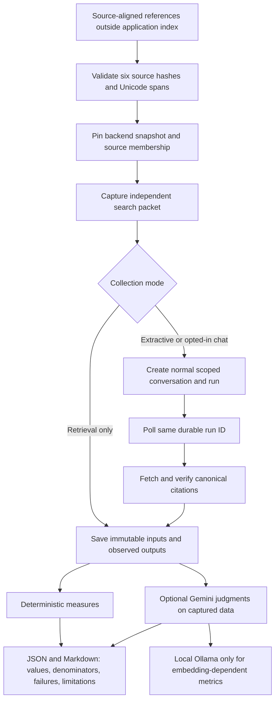

# Evaluation workflow, metric verification and interpretation

All collection/scoring/report commands now generate `report.pdf` automatically.
See [PDF reporting](pdf_reporting.md) for the template, configuration audit,
future metric discovery and offline regeneration instructions.

Prepared 18 November 2026. This is the separately authorized evaluation track. It does not retroactively convert the original three backend phases into a quality benchmark.

## 1. Boundaries and provider policy

Everything evaluation-owned belongs under /testbed: source, dependency metadata, environment, datasets, metric/judge prompts/adapters, tests, notes and generated reports. Generated/private artifacts belong under ignored testbed/.runtime. The original backend is treated as an HTTP system under test.

- Runtime planning/drafting/review: existing Groq backend.
- Evaluation judgments: explicitly configured Gemini only.
- All embedding inference, including evaluation question similarity: local Ollama only.
- Source integrity and metric arithmetic: deterministic Python.
- No backend imports, direct database reads/writes, admin routes, snapshot activation or reindexing.
- No account rotation, paid fallback, cloud embedding default, import-time provider call or automatic model pull.
- Judge settings are independent from backend/.env. Gold answers are never sent to backend search or generation.

The initial confirmed corpus contains **six**, not five, contracts. Original source files remain read-only.

## 2. Questions this testbed can and cannot answer

The current executable pilot measures whether a literal definition can be recovered and cited from each known agreement. It supports retrieval-only, explicit extractive/source-only chat, and opted-in ordinary Groq chat capture.

It does not yet contain expert-adjudicated termination/closing-condition cases, negative/abstention golds, cross-agreement comparisons, multi-turn cases, or switches that disable graph/CRAG independently. Those are the next dataset/harness extensions, not measured results.

A perfect extractive score cannot demonstrate that an LLM interpreted a legal exception correctly. Six agreements and repeated definition families are also not independent evidence of broad legal-domain generalization.

## 3. Data contract and annotation workflow

pilot.jsonl has 18 strict Case records:
- Safe case ID, question, selected agreement IDs, category.
- Reference answer and one or more reference source spans.
- Each source span: agreement ID, original raw-byte SHA-256, end-exclusive Unicode [start,end), exact quote.
- Optional defined_term selector for the exact-control path.
- Expected behavior: answer, abstain or clarify.
- Review status: draft, source_verified or human_reviewed.
- Dataset revision and notes.

Source_verified means the literal definition and byte/hash/Unicode alignment were checked; it is **not** legal-expert adjudication. The current reference answer is the verbatim definition, with paraphrasing assessed only by optional semantic metrics. Curly quotes and abbreviations are preserved.

The pilot preparation script checks the six frozen raw hashes and picks reviewed literal-definition boundaries without importing the backend parser. It refuses ambiguous candidate definitions or unexpectedly long boundaries. Preparing source-aligned data is assistance, not an independent expert annotation process. Never make the production parser its own benchmark oracle.

To expand:
1. Select an operative source passage and actual dependencies, not a table-of-contents entry.
2. Write the question independently of the current system answer.
3. Record each material condition/exception as separate reference evidence when possible.
4. Draft a concise reference that preserves qualifications and admits unavailable material.
5. Record acceptable interpretations and expected answer/clarification/abstention behavior.
6. Have a second reviewer adjudicate, especially negative claims or legal interpretation. Preserve disagreement.
7. Validate hashes/ranges mechanically; mark human_reviewed only after actual review.
8. Freeze question families before tuning; reserve held-out families/agreements as practical.

The current strict schema has no multi-turn or detailed required-fact rubric fields. Add a versioned schema/runner extension for those rather than silently stuffing them into unsupported fields.

Never use lack of a retrieved answer to label a question unanswerable. MAUD annotation excerpts/labels can seed candidates, but are not automatically aligned to full-document offsets or all requested qualifications.

## 4. Freeze the system under test

The collector requests health, the active snapshot and approved document versions through HTTP. It requires a live Ollama embedding profile and checks reference hashes/versions against snapshot membership.

A run manifest pins dataset fingerprint/case IDs, backend origin, snapshot, embedding profile, collection mode and search mode. Chats explicitly pin that snapshot. Fresh source/index/configuration needs a new capture directory, never a blended average.

Chat traces retain the backend's model/prompt/configuration fingerprints. Reports record the local deterministic metric code SHA. Keep the testbed lockfile and judge journal identity with any published result.

Directory names are labels, not evidence of actual behavior: a directory named pilot_hybrid may still contain lexical degradation. The reported actual_retrieval_modes and warnings are authoritative.

## 5. Collection workflow

Collection sends only the question, scope and normal endpoint options to the backend. Reference answers remain testbed-side.

For retrieval mode, capture the returned groups, order, graph paths, warnings and limits. For chat, also capture conversation/run IDs, result, trace and canonical citation checks. Exact/source-only control makes no hosted generation call.

Requests are sequential; the testbed does not increase app budgets or create parallel runs to bypass quotas. Submission keys persist before POST; retries use the same body/key. A wait timeout preserves the in-progress run for resume, without implicit cancellation or resubmission.

HTTP/admin source/index changes are forbidden. The existing backend continues enforcing authorization and immutable evidence boundaries.

## 6. Deterministic metrics

| Report field | Calculation | Interpretation |
|---|---|---|
| annotated_span_coverage_at_3/6 | Mean union-covered fraction of reference ranges in first 3/6 returned excerpts | Partial evidence visibility, not semantic support |
| annotated_span_coverage_all | Mean union-covered fraction over complete returned packet | Can reveal useful evidence added late by graph expansion |
| evidence_recall_at_3/6 | Fraction of reference units with at least 95% range coverage | Mechanical required-evidence recovery |
| required_evidence_complete | All labelled units meet the 95% threshold | Span criterion only, not legal completeness |
| mrr | Reciprocal first returned position covering at least 50% of any reference unit | Ordering diagnostic on delivered evidence |
| scope_violation_count | Returned agreements outside selected scope | Must be investigated; not an LLM confidence score |
| citation_integrity | Per-case fraction of checked citations passing integrity | Macro aggregation in ordinary metric table |
| citation_integrity_micro | All valid citations / all checked citations | Quote/version/hash/range integrity, not entailment |
| chat_scope_valid | Result snapshot/agreement/version scope matches pinned conversation | Detects scope drift |
| answer_emission_rate | Answerable semantic completions producing claims | Coverage of answering; not correctness |
| false_abstention_rate | Answerable semantic completions returning insufficient_evidence | Missed opportunity to answer |
| correct_abstention_rate | Gold-unanswerable semantic completions returning insufficient_evidence | Not available in the current positive-only pilot |

Intervals are unioned so overlapping/duplicate chunks cannot inflate coverage. A 95% match could still omit a legally crucial phrase; split material qualifiers into their own evidence units and use human/semantic review.

MRR/at-k apply only to a single selected agreement. The backend groups multi-agreement results and does not return a global ranking, so the testbed does not invent one. Ordering is that of delivered seeds/expanded excerpts, not an export of the original top-20 candidate ranks.

Empty references or absent citations produce undefined/null where appropriate, not perfect values. Report missing capture errors separately. Required-evidence success over all planned cases treats missing successful captures as not established; conditional means retain their scored denominator.

Citation verification checks source/version, agreement scope, exact code-point slicing, and text hashes against the canonical evidence endpoint. It does not prove the cited statement entails the claim.

Abstention metrics exclude operational service_unavailable completions from their semantic denominator. Report the excluded failures and overall capture counts alongside them. An architecture that refuses every question is not successful merely because it avoids unsupported claims.

## 7. Ragas metrics and their limits

Ragas is pinned to the 0.4.x legacy metric interface; initial resolved version is **0.4.4**. These concrete classes and their arithmetic are tested. They emit deprecation warnings; an upgrade requires explicit migration and renewed calibration.

| Output name | Ragas implementation | Data and meaning |
|---|---|---|
| context_precision | LLMContextPrecisionWithReference | Rank-weighted relevance of independently captured search excerpts to the reference |
| context_recall | LLMContextRecall | Fraction of reference statements attributable to those excerpts |
| response_relevancy | AnswerRelevancy | Generates questions from an answer and compares their embeddings with the original question |
| factual_correctness | FactualCorrectness | Claim-based agreement of actual answer with reference; not a legal certification |
| citation_groundedness_proxy | Faithfulness over final cited quotes | Whether answer claims are supported by its cited quotations; explicitly a proxy |
| generation_faithfulness | Not calculated with current server | Requires actual per-generation model-visible context, which HTTP does not expose |

Context precision is not computed for a multi-agreement packet lacking global rank. Response metrics require a substantive chat answer. Invalid citation integrity prevents treating cited context as verified proxy evidence.

Ragas Faithfulness asks whether response claims are supported by context. This differs from whether the reference is complete or the answer legally correct. Response relevance can be high for a wrong but on-topic answer. Its cosine calculation is not a probability and need not be bounded by zero.

Sources: [faithfulness](https://docs.ragas.io/en/stable/concepts/metrics/available_metrics/faithfulness/), [precision](https://docs.ragas.io/en/stable/concepts/metrics/available_metrics/context_precision/), [recall](https://docs.ragas.io/en/stable/concepts/metrics/available_metrics/context_recall/), [relevancy](https://docs.ragas.io/en/stable/concepts/metrics/available_metrics/answer_relevance/).

### Why true generation faithfulness is unavailable

Backend tool traces expose evidence IDs, not a full immutable ranked packet or exact per-call model payload. The selected context can change, and backend payload fitting can omit excerpts.

Therefore:
- Fresh search results are not automatically the chat model's context.
- Final citations are not the complete context shown to drafting/revision.
- Final selected evidence cannot reliably reconstruct earlier model inputs.
- A citation-groundedness proxy must never be renamed generation faithfulness.

Full faithfulness needs a verified per-call context receipt from the application. Adding that export would require separately reviewed application work; the current testbed does not modify or monkey-patch the backend.

## 8. Verify calculations before trusting judges

Executable tests exercise the installed Ragas methods with controlled intermediate judgments:

| Fixture | Expected |
|---|---:|
| Three response statements, verdicts 1/0/1 | Faithfulness 2/3 |
| Three reference statements, attribution 1/0/1 | Context recall 2/3 |
| Ranked relevance 1/0/1 | Rank-weighted context precision 5/6 |
| No faithfulness/recall statements | Undefined NaN converted to null in reports |
| Overlapping reference intervals | Count covered characters once |
| Emoji citation | Correct code-point slicing; no UTF-16 confusion |
| Wrong source hash or changed source text | Validation failure |
| Altered cited text hash | Integrity failure |
| Missing Gemini key/confirmation | No network call |
| Ragas relevance embeddings | Explicit Ollama adapter, never cloud client |
| Gemini repeated identical request | Cached result, no extra physical call |
| Exhausted judge budget | Pending, no request |
| Actual Ragas scoring plumbing | Mocked Gemini classification yields known 2/3 |

The fixed arithmetic tests prove the implementation combines judgments correctly. They do not prove Gemini supplied correct judgments.

Before meaningful judge-based claims, calibrate on independently reviewed correct, incomplete, subtly wrong, conflicting and unsupported answers. Compare judgments, examine disagreements and repeat a subset. Gemini must not author and approve the gold standard alone. No calibrated judge accuracy is currently claimed.

## 9. Judge execution, reproducibility and cost controls

Gemini is configured explicitly with a key/model/free-tier confirmation in testbed/.env. No model ID or paid substitution is silently selected. Verify current availability/account quotas; the old application Gemini configuration is not reused.

Explicit adapters bypass Ragas provider auto-matching. All evaluation embeddings use local Ollama with the pinned snapshot model/digest/runtime. Response relevancy compares questions with generated questions, so both use the query prefix. Embedding cache identity includes profile, evaluation task and complete text. Invalid/oversized inputs fail instead of being truncated or sent elsewhere.

The journal reserves physical calls before sending, saves usage/response cache, and includes prompt/model/SDK/Ragas/temperature/completion identity. Separate generated completions do not all reuse one cached answer. Schema-repair calls are still subject to the physical budget.

SDK retries are disabled. Ragas generic LLM retry wrappers are bypassed in favor of explicit accounting. A failure blocks immediate further calls; quota RetryInfo is honored conservatively. Budget defaults are 2 RPM and 40 calls, not an invitation to exceed account limits. Resume only after provider recovery; never reset a journal to evade limits or rotate accounts. Judge scoring can resume independently of backend generation.

Cached scores are bound to observation hashes. Changed captures invalidate old scores. A report excludes stale score files, and offline scoring does not overwrite valid existing judge values for unchanged observations.

Gemini/Ragas telemetry is disabled before Ragas import. Optional transitive OpenAI packages are installed for library compatibility but no OpenAI/Google embedding factory is invoked. Keys, authorization headers and raw provider exception bodies are not written to reports.

## 10. Status and denominator policy

- scored: finite measured value, with applicable case count.
- pending: provider not enabled/configured, collection incomplete, judge budget exhausted, or recoverable provider/scoring error.
- unavailable: required observation is absent, such as exact generation context.
- not_applicable: no answer for an answer-dependent metric, or no global ranking for ranked multi-agreement precision.
- undefined: the metric actually ran but returned a non-finite result.

Zero is a measured result, not a substitute for missing data. A report must show planned, observed, completed captures, errors, judge coverage, reference-review status, actual retrieval modes, and outcomes.

Report semantic quality conditional on valid answers alongside answer emission/abstention and operational availability. Never publish a single “overall accuracy” average over incomparable metrics.

## 11. Interpretation examples

| Observation | Likely interpretation / investigation |
|---|---|
| High reference recall, low correctness | Evidence was present but synthesis or interpretation failed |
| Low top-6 recall, higher full-packet coverage | Needed evidence arrived through later expansion or ordering needs improvement |
| High faithfulness proxy, low reference coverage | Answer may be well supported but incomplete |
| Correct quote/hash, unsupported claim | Provenance works; semantic entailment fails |
| Good scores on a small answered subset, many abstentions | Coverage problem; conditional quality hides refusal |
| High exact control, weak auto search | Lookup/parsing may work while query retrieval/ranking is weak |
| Lexical fallback during auto mode | Valid degraded search observation, not a hybrid success |
| Source-only control passes | Evidence plumbing works; no conclusion about Groq reasoning |
| HTTP/service/judge outage | Availability failure, not proof a document question is unanswerable |
| Wrong-scope evidence | Isolation defect regardless of semantic relevance |

## 12. Practical execution sequence

1. Install the independent testbed with its lockfile.
2. Validate local gold sources; do not regenerate reviewed annotations casually.
3. Run preflight; remember backend readiness checks configuration/stores, not live Ollama/Groq availability.
4. Verify local embedding preflight. If the pinned model is absent, restore it as an explicit operator action and verify digest/runtime before a new hybrid cohort. No automatic pull/profile alteration.
5. Collect retrieval and exact controls in different run directories.
6. Inspect actual modes and errors before interpreting metrics.
7. Collect a small opted-in Groq chat cohort, respecting app/global quotas.
8. Validate citations and inspect false abstentions.
9. Configure optional Gemini and score captured outputs under a small call budget.
10. Calibrate against human labels; expand to conditional/cross-reference/negative/multi-turn questions.
11. Keep tuning and held-out question families separate; record repeat variability.
12. Add fair graph/CRAG ablations only when controlled switches exist and scopes/budgets remain equivalent.

Generated data is under testbed/.runtime/<run>:
- manifest.json: frozen capture identity.
- observations/<case>.json: resumable request/run and observed outputs.
- scores/<case>.json: bound metric values/statuses.
- judge_journal.json: Gemini attempt budget/response cache.
- embedding_cache/: local evaluation embeddings.
- report.json / report.md: machine/human summaries.

Do not modify the application's index/model profile simply to obtain a greener evaluation report.

## 13. Initial state and unresolved work

See [initial measured findings](reports/pilot_findings.md). The initial live runs are lexical-degraded auto retrieval and exact/source-only control, not full generative or genuine hybrid quality evaluation.

Outstanding: restore the missing pinned EmbeddingGemma model, configure the optional Gemini evaluation model/key, calibrate judges, add human-adjudicated legal/negative/multi-turn cases, and obtain actual-context receipts if full generation faithfulness is needed. All testbed-related follow-up work stays under /testbed; changes to the original app require a separate explicit request.
